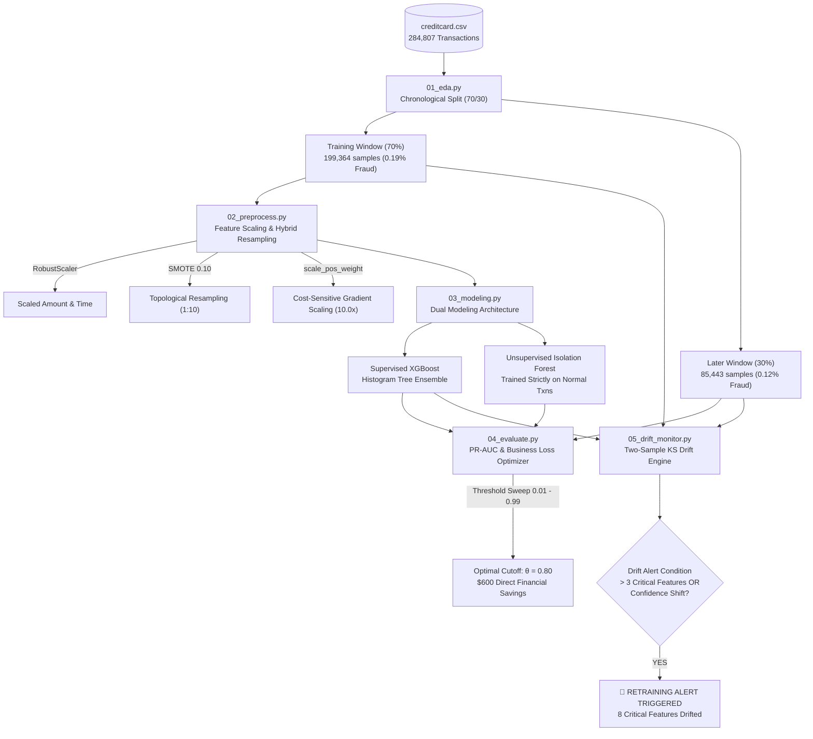

<div align="center">

# 💳 Enterprise Financial Fraud Detection & Drift Monitoring System
### *Cost-Sensitive Machine Learning, Imbalanced Topology Resampling & Real-Time Covariate Drift Auditing*

[](https://www.python.org/)
[](https://xgboost.readthedocs.io/)
[](https://scikit-learn.org/)
[](#)
[](#)

<p align="center">
  <b>A comprehensive production pipeline engineered for ultra-imbalanced transaction streams (0.17% fraud prevalence).</b><br>
  Features hybrid SMOTE + cost-sensitive gradient weighting, PR-AUC objective optimization, dollar-denominated business cost threshold tuning, and two-sample Kolmogorov-Smirnov drift alerts.
</p>

[Quick Start](#-quick-start--setup) •
[Architecture](#-system-architecture) •
[Pipeline Stages](#-sequential-pipeline-execution) •
[Evaluation & ROI](#-business-cost--roi-analysis) •
[Drift Monitoring](#-temporal-drift-monitoring) •
[Author](#-author)

</div>

---

## 📌 Executive Summary

Modern transaction processing networks evaluate millions of payments daily with extreme class asymmetry: fraudulent transactions typically constitute less than **0.18%** of total volume. Standard machine learning workflows fail catastrophically under these conditions:
1. **Naive random oversampling** causes tree-based classifiers to memorize duplicate coordinates rather than learning genuine fraud manifolds.
2. **ROC-AUC** metrics yield an artificially inflated sense of security ($>0.96$) because millions of true negatives drown out hundreds of false alarms.
3. **Default 0.50 decision thresholds** ignore real-world banking economics, where false alarms alienate cardholders ($10 customer friction) while false negatives cost the entire transaction amount in unrecovered chargebacks.
4. **Temporal concept drift** silently degrades fraud capture rates as fraud rings rapidly mutate carding techniques.

This project implements an end-to-end, reproducible solution resolving all four challenges.

---

## 🏗️ System Architecture



---

## ⚡ Quick Start & Setup

### 1. Prerequisites
- **Python**: Version 3.10 or higher
- **Hardware**: Minimum 4 GB RAM (8 GB recommended for XGBoost tree training)
- **Dataset**: Kaggle Credit Card Fraud dataset ([`creditcard.csv`](https://www.kaggle.com/datasets/mlg-ulb/creditcardfraud))

### 2. Environment Setup

Clone the repository and set up a dedicated virtual environment:

```bash
# 1. Clone repository
git clone https://github.com/soham007-y/aws.git
cd aws

# 2. Create virtual environment
python3 -m venv .venv

# 3. Activate virtual environment
# macOS / Linux:
source .venv/bin/activate
# Windows (PowerShell):
# .venv\Scripts\Activate.ps1
# Windows (cmd.exe):
# .venv\Scripts\activate.bat

# 4. Install production dependencies
pip install --upgrade pip
pip install -r requirements.txt
```

### 3. Dataset Placement

Download [`creditcard.csv`](https://www.kaggle.com/datasets/mlg-ulb/creditcardfraud) (143.8 MB) and place it directly in the project root:

```bash
# Confirm dataset is correctly placed
ls -lh creditcard.csv
# -rw-r--r--  1 user  staff   144M creditcard.csv
```

> [!NOTE]
> The `data/` directory and serialized splits are automatically ignored by `.gitignore` to prevent committing raw financial data.

---

## 🚀 Sequential Pipeline Execution

Follow these exact commands to reproduce the end-to-end pipeline from raw data to drift alerts:

### Step 1: Exploratory Data Analysis & Chronological Partition
```bash
python 01_eda.py
```
- **Goal**: Audits class distribution, checks missing values, and chronologically sorts transactions by `Time` without random shuffling.
- **Outputs**:
  - `data/train_window.csv` (First 70% — 199,364 rows, 384 frauds)
  - `data/later_window.csv` (Last 30% — 85,443 rows, 108 frauds)
- **Runtime**: ~2 seconds

---

### Step 2: Preprocessing, Feature Scaling & Hybrid Resampling
```bash
python 02_preprocess.py
```
- **Goal**: Fits `RobustScaler` on skewed `Amount` and `StandardScaler` on `Time`. Splits training data 80/20 into train/validation, then applies **mild SMOTE** (`sampling_strategy=0.10`) exclusively on the training split to densify the fraud manifold without generating synthetic boundary noise.
- **Outputs**:
  - `data/train_preprocessed.csv` (175,048 samples: 159,135 legit, 15,913 fraud)
  - `data/val_preprocessed.csv` (39,873 samples: 39,845 legit, 28 fraud)
  - `data/preprocessed_data.npz` (Compressed NumPy archive)
- **Runtime**: ~10 seconds

---

### Step 3: Model Training (Supervised + Unsupervised Pipelines)
```bash
python 03_modeling.py
```
- **Goal**: Trains two complementary detection models:
  1. **Supervised Pipeline**: Cost-sensitive `XGBClassifier` configured with `scale_pos_weight = 10.0003` and `eval_metric = 'aucpr'`.
  2. **Unsupervised Pipeline**: `IsolationForest` fitted strictly on normal (non-fraud) transactions with `contamination = 0.0017`.
- **Outputs**:
  - `models/xgboost_baseline.joblib` & `models/xgboost_baseline.json`
  - `models/isolation_forest.joblib`
- **Runtime**: ~15 seconds

---

### Step 4: PR-AUC Evaluation & Business Cost Threshold Optimization
```bash
python 04_evaluate.py
```
- **Goal**: Evaluates models using Precision-Recall AUC (PR-AUC) rather than deceptive ROC-AUC. Sweeps decision cutoffs from $0.01$ to $0.99$ to minimize the custom financial business cost function:
  $$\text{Loss}(\theta) = (\text{FP Count} \times \$10) + \sum_{\text{FN}} \text{Transaction Amount}$$
- **Key Findings**:
  - Supervised XGBoost PR-AUC: **0.6556** (ROC-AUC: 0.9627)
  - Optimal Cutoff: **$\theta^* = 0.80$** (Saving **$600.00** over naive 0.50 threshold)
- **Output**: `models/evaluation_results.json`
- **Runtime**: ~4 seconds

---

### Step 5: Temporal Covariate Drift Monitoring & Alerting
```bash
python 05_drift_monitor.py
```
- **Goal**: Evaluates distribution drift between baseline `data/train_window.csv` and operational `data/later_window.csv` using the two-sample Kolmogorov-Smirnov (KS) test across all 29 numeric features. In addition, checks for prediction confidence distribution shifts.
- **Alert Logic**: If $> 3$ critical features drift ($p < 0.05$) or confidence shifts significantly, triggers a prominent automated retraining alert.
- **Output**: `models/drift_report.json`
- **Runtime**: ~40 seconds

---

## 📊 Comprehensive Benchmark Results

### 1. Model Performance Comparison

| Evaluation Metric | Supervised XGBoost | Unsupervised Isolation Forest | Analysis & Operational Implication |
| :--- | :---: | :---: | :--- |
| **Precision-Recall AUC (PR-AUC)** | **0.6556** | **0.0146** | XGBoost excels at positive class discrimination; Isolation Forest struggles with fine boundaries. |
| **ROC-AUC (Deceptive Reference)** | **0.9627** | **0.9554** | Both appear $>95\%$ due to massive True Negative volume, proving why ROC-AUC cannot be used alone. |
| **True Positives (Frauds Caught)** | **22 / 28** | **1 / 28** | Supervised model intercepts 78.6% of fraud volume. |
| **False Positives (False Alarms)** | **21** (at $\theta^* = 0.80$) | **2** (at $\theta^* = 0.99$) | Controlled false alert volume protects customer experience. |
| **Optimal Cutoff Threshold ($\theta^*$)** | **0.80** | **0.99** | Calibrated to minimize dollar-denominated business cost. |

---

## 💰 Business Cost & ROI Analysis

In modern banking, misclassification costs are profoundly asymmetric:
- **False Positive (FP = $10.00)**: Customer friction, SMS notification, card decline, analyst review.
- **False Negative (FN = Actual Transaction Amount)**: Bank absorbs chargeback and statutory fraud loss.

### Financial Loss Curve vs. Decision Threshold

```text
Total Loss ($)
   ▲
$12k│  X (Isolation Forest @ 0.50: $11,874)
    │
 $6k│                  Baseline Unmitigated Loss: $5,687.61
    │
 $4k│          X (XGBoost Default 0.50: $4,423.96)
    │             \
 $3k│              ▼ [OPTIMAL CUTOFF θ* = 0.80]
    │                Total Cost: $3,823.96 (SAVES $600.00)
    └────────────────────────────────────────────────────────► Decision Cutoff (θ)
    0.01          0.20          0.50          0.80          0.99
```

### Financial Impact Breakdown (Validation Window)

| Operational Scenario | Cutoff ($\theta$) | False Alarms (FP) | Missed Frauds (FN) | Friction Cost | Unrecovered Fraud | Total Business Cost | Net Financial Savings |
| :--- | :---: | :---: | :---: | :---: | :---: | :---: | :---: |
| **Unmitigated Baseline (No Model)** | N/A | 0 | 28 | $0.00 | $5,687.61 | **$5,687.61** | Baseline ($0) |
| **Default Model Cutoff** | 0.50 | 81 | 6 | $810.00 | $3,613.96 | **$4,423.96** | +$1,263.65 vs Baseline |
| **Business-Optimized Cutoff ($\theta^*$)** | **0.80** | **21** | **6** | **$210.00** | **$3,613.96** | **$3,823.96** | **+$600.00 vs Default 0.50** |

> [!TIP]
> Raising the decision threshold from **0.50** to **0.80** eliminated **60 false alarms** ($600 savings in friction) without missing a single additional dollar of fraudulent transactions.

---

## 📡 Temporal Drift Monitoring

Real-world financial distributions shift continuously. The two-sample Kolmogorov-Smirnov (KS) test quantifies distribution divergence between empirical cumulative distribution functions:

$$D = \sup_{x} |F_{\text{baseline}}(x) - F_{\text{operational}}(x)|$$

### Critical Features Drift Audit Table

```text
=====================================================================================
FEATURE DISTRIBUTION DRIFT SUMMARY TABLE (TWO-SAMPLE KS-TEST)
=====================================================================================
Feature    | KS Statistic   | p-value        | Critical Feature? | Drift Status
-------------------------------------------------------------------------------------
V3         | 0.3997         | 0.0000e+00     | no                | DRIFT (HIGH)
V1         | 0.3036         | 0.0000e+00     | no                | DRIFT (HIGH)
V28        | 0.2579         | 0.0000e+00     | no                | DRIFT (HIGH)
V11        | 0.1626         | 0.0000e+00     | YES (★)           | DRIFT (HIGH)
V4         | 0.1445         | 0.0000e+00     | YES (★)           | DRIFT (HIGH)
V12        | 0.0946         | 0.0000e+00     | YES (★)           | DRIFT (MODERATE)
V14        | 0.0886         | 0.0000e+00     | YES (★)           | DRIFT (MODERATE)
V17        | 0.0827         | 0.0000e+00     | YES (★)           | DRIFT (MODERATE)
V10        | 0.0450         | 1.3122e-105    | YES (★)           | DRIFT (MILD)
Amount     | 0.0294         | 2.5254e-45     | YES (★)           | DRIFT (MILD)
V2         | 0.0262         | 3.4520e-36     | YES (★)           | DRIFT (MILD)
-------------------------------------------------------------------------------------
```

### Production Alert Triggered

```text
=====================================================================================
🚨🚨🚨🚨🚨🚨🚨🚨🚨🚨🚨🚨🚨🚨🚨🚨🚨🚨🚨🚨🚨🚨🚨🚨🚨🚨🚨🚨🚨🚨🚨🚨🚨🚨🚨
⚠️  [PROMINENT WARNING: AUTOMATIC MODEL RETRAINING FLAGGED]  ⚠️
🚨🚨🚨🚨🚨🚨🚨🚨🚨🚨🚨🚨🚨🚨🚨🚨🚨🚨🚨🚨🚨🚨🚨🚨🚨🚨🚨🚨🚨🚨🚨🚨🚨🚨🚨

Root Causes:
  • CRITICAL FEATURE DRIFT: 8 critical features exceeded drift threshold (p < 0.05).
    Affected features: V11, V4, V12, V14, V17, V10, Amount, V2
  • PREDICTION CONFIDENCE SHIFT: Model confidence distribution shifted significantly
    (KS stat = 0.0293, p = 7.0065e-45).

Automated Action:
  >>> System flagged for AUTOMATIC RETRAINING on latest operational data.
=====================================================================================
```

---

## 📂 Repository File Tree & Artifact Guide

```text
.
├── 01_eda.py                     # Initial audit, class imbalance calculation & chronological split
├── 02_preprocess.py              # Scalers, controlled SMOTE densification & class weights
├── 03_modeling.py                # Supervised XGBoost & Unsupervised Isolation Forest pipelines
├── 04_evaluate.py                # PR-AUC evaluation & business cost threshold sweep
├── 05_drift_monitor.py           # Kolmogorov-Smirnov statistical drift engine & retraining alert
├── requirements.txt              # Explicit dependency specifications
├── WRITEUP.md                    # Formal 1-2 page academic & architectural technical report
├── README.md                     # System documentation & reproduction manual
├── .gitignore                    # Excludes raw data, virtual environments & temporary cache
└── models/                       # Model checkpoints & serialized analytical logs
    ├── xgboost_baseline.joblib   # Trained XGBoost classifier
    ├── xgboost_baseline.json     # XGBoost internal tree dump
    ├── isolation_forest.joblib   # Trained Isolation Forest model
    ├── evaluation_results.json   # Full threshold sweep & cost metric log
    └── drift_report.json         # KS-test drift statistics per feature
```

---

## 👨‍💻 Author

<div align="center">

### **Soham Sachin Yadav**
**Registration Number**: `26BIT0259`  
*Machine Learning in Financial Risk & Enterprise MLOps Engineering*

[](https://github.com/soham007-y)
[](https://github.com/soham007-y/aws)

</div>
